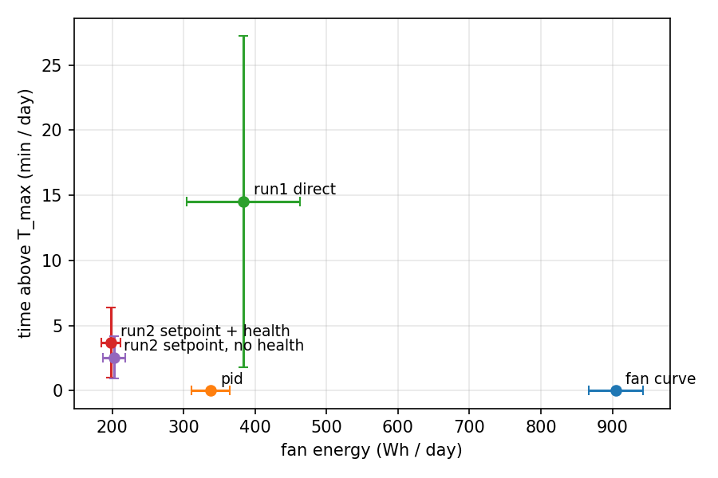
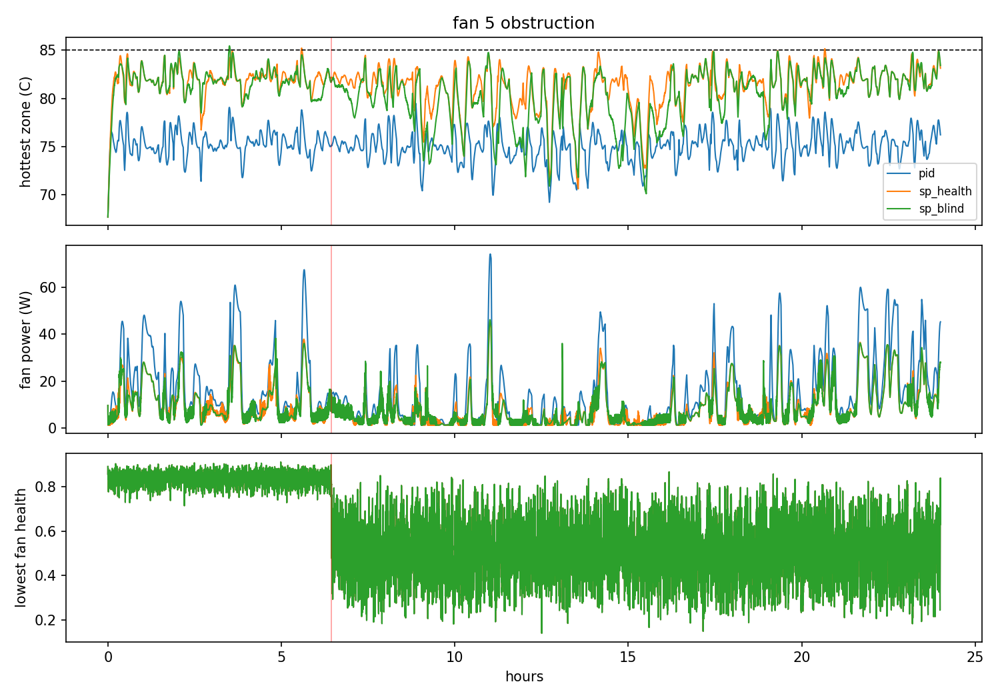

# Earshot

Fan control for a server rack that listens to its own fans.

Fans wear out, and the usual fan controller (a temperature curve or a PID loop) only finds out once things are already getting hot. Earshot adds two things on top of that:

1. An acoustic anomaly detector, trained only on recordings of normal fans, that gives every fan a health score between 0 and 1.
2. A reinforcement learning agent (PPO with a Lagrangian safety constraint) that uses those health scores, along with temperatures and load, to decide how hard the fans should work.

The aim is to use less fan energy than PID without any zone going over 85 C, including when a fan starts to fail.

Everything runs on a simulated rack for now. The live demo part listens to a real fan through a laptop microphone.

## Where it stands

| Part | Status |
| --- | --- |
| Rack simulator, fault injection, Gymnasium env | done, tested |
| Fan curve and PID baselines | done |
| PPO-Lagrangian agent | done, two training runs below |
| Detector code (GMM, dense AE, conv AE, kNN), ONNX export, live mic scoring | done, tested on synthetic audio only |
| Detector on the real MIMII / DCASE fan data | **not run yet** |
| Run 3 (tighter safety constraint) | in progress |

Until the detector is trained on MIMII, the simulator uses a synthetic stand-in for it (`AudioBridge.synthetic`). So the results below say nothing yet about how well the real detector works.

## How the simulation works

- **Rack:** 4 server zones cooled by a wall of 6 fans, stepped every 5 s. Each zone is a lumped thermal mass. Heat removal scales with airflow^0.8, and fan power scales with speed^3 (the fan affinity law). The airflow layout is set so the rack survives any single dead fan at full load, the way real servers are built with N+1 fans.
- **Load:** a synthetic daily cycle with random bursts. Real Alibaba cluster traces can be swapped in.
- **Faults:** bearing wear (airflow drops slowly and power draw rises), obstruction (airflow halves) and stall (the fan stops). At most one fault per day.
- **Audio bridge:** every step, each fan gets the health score the detector would give for a clip of a fan in that state. A worn fan starts to *sound* wrong before it loses much airflow. How much earlier is a setting (`audio_lead`), not a measurement.
- **Reward:** less fan power is better. **Cost:** degrees above 85 C. The Lagrange multiplier λ raises the penalty on cost whenever the agent goes over its cost limit.

## Results so far

Both runs are 2M environment steps on a laptop CPU. They are evaluated on the same 3 held-out 24-hour days (seed 1000), with and without a fan fault. Energy is fan energy only.

**Days without faults**

| Controller | Fan energy (Wh/day) | vs PID | Time over 85 C (min/day) | Hottest point |
| --- | --- | --- | --- | --- |
| Fan curve | 860.5 | +182% | 0 | 70.8 C |
| PID (setpoint 75 C) | 305.1 | - | 0 | 79.2 C |
| Run 1: agent sets fan speeds | 345.0 | +13% | 15.9 | 86.4 C |
| Run 2: agent sets PID setpoints, hears fan health | 179.1 | **-41%** | 1.1 | 85.2 C |
| Run 2: same, without fan health | 182.6 | -40% | 1.9 | 85.7 C |

**Days with one fan fault**

| Controller | Fan energy (Wh/day) | vs PID | Time over 85 C (min/day) | Hottest point |
| --- | --- | --- | --- | --- |
| Fan curve | 904.5 | +168% | 0 | 71.0 C |
| PID (setpoint 75 C) | 337.5 | - | 0 | 79.5 C |
| Run 1: agent sets fan speeds | 383.7 | +14% | 14.5 | 87.9 C |
| Run 2: agent sets PID setpoints, hears fan health | 198.1 | **-41%** | 3.7 | 85.8 C |
| Run 2: same, without fan health | 202.6 | -40% | 2.6 | 85.5 C |



### Run 1: the agent sets every fan speed directly

This failed. After 2M steps (13 minutes of training), the agent used more energy than PID *and* ran over 85 C for about 15 minutes a day. λ climbed to 5.6 and never settled.

Two reasons. The agent had to learn basic temperature control from scratch, which PID gets for free. And its fan speeds jittered from step to step; with power growing as speed cubed, an unsteady fan costs more than a steady one at the same average speed.

### Run 2: the agent picks a temperature target for each zone, and PID drives the fans

I first planned to have the agent add small speed corrections on top of PID. That doesn't work: PID's integral term slowly cancels any steady correction. So the agent moved one level up. Every 5 s it picks a setpoint between 70 and 82 C for each zone, and PID does the actual fan control.

This saved about 40% of PID's fan energy on both kinds of day. The replay below shows how: the agent keeps the hottest zone around 82 C where PID holds 75 C, and gives back headroom when load jumps.



### What these numbers do and don't show

- **Most of the saving comes from running hotter.** PID at 75 C is a conservative baseline. Before I claim the 40%, I need to compare against a PID tuned for the lowest energy with zero time over the limit (`scripts/tune_pid.py`).
- **Run 2 still goes over the limit,** by under 1 C, for 1 to 4 minutes a day. λ stayed at 0 for the whole run. The cost limit (0.02 degrees per step on average) was far looser than the actual cost (about 0.002), and λ's learning rate was too small to react at that scale. Run 3 tightens both settings (`cost_limit: 0.0002`, `lambda_lr: 5.0`, now the defaults in `configs/ppo_lag.yaml`).
- **Hearing fan health made no difference yet.** The two run 2 agents are within noise of each other. That's expected when nothing pushes the agent to be careful: health information only pays off once safety matters. Run 3 is the real test of that.
- **The detector in these runs is synthetic.** The numbers say nothing about MIMII performance.

## Layout

```
earshot/audio     features, detectors (GMM, dense AE, conv AE, kNN), training, live mic scoring, ONNX export
earshot/sim       rack thermal model, workloads, fault injection, audio bridge, Gymnasium env
earshot/control   fan curve + PID, PPO-Lagrangian, setpoint supervisor, training, evaluation
earshot/app       Streamlit dashboard (live fan + replays)
configs/          rack.yaml, detector.yaml, ppo_lag.yaml
scripts/          data download, recording, Alibaba trace prep, PID tuning, plots
results/          evaluation CSVs and the plots above
tests/            pytest, 30 tests
```

## Setup

```
pip install -e .
pytest
```

## Reproducing the two runs

Both runs used the old cost settings, so pass them explicitly:

```
python -m earshot.control.train --out runs/control/run1_direct --action speeds --cost-limit 0.02 --lambda-lr 0.05
python -m earshot.control.train --out runs/control/run2_setpoint_health --cost-limit 0.02 --lambda-lr 0.05
python -m earshot.control.train --out runs/control/run2_setpoint_blind --cost-limit 0.02 --lambda-lr 0.05 --no-health

python -m earshot.control.evaluate curve pid runs/control/run2_setpoint_health/policy.pt runs/control/run2_setpoint_blind/policy.pt --scenario faults --days 3
python scripts/plots.py pareto results/eval_faults.csv
python scripts/plots.py replay results/trace_faults.npz
```

The trained policies from these runs are in `runs/control/` (kept out of git). The evaluation rows behind the tables are in `results/combined_clean.csv` and `results/combined_faults.csv`.

## Detector (next)

```
bash scripts/download_mimii.sh
python -m earshot.audio.train --model gmm
python -m earshot.audio.train --model ae
python -m earshot.audio.score runs/detector/dcase_ae.joblib       # health scores for the simulator
python -m earshot.audio.export runs/detector/dcase_ae.joblib      # ONNX + INT8, prints latency
python -m earshot.control.train --out runs/control/earshot --bridge runs/bridge/dcase_ae.npz
```

Live demo on your own fan:

```
python scripts/record.py idle --seconds 300
python scripts/record.py load --seconds 300
python scripts/record.py blocked --seconds 120
python -m earshot.audio.train --model ae --layout own
python -m earshot.audio.live runs/detector/own_ae.joblib
streamlit run earshot/app/dashboard.py
```

## Limitations

- The thermal model is lumped RC, not CFD. It's plausible, not accurate.
- How early sound gives a fault away is something I chose (`audio_lead`), so any lead-time result depends on that choice. It should be swept, and the GMM detector swapped in as a weaker one, before drawing conclusions.
- MIMII fans are industrial fans, not server fans. That's why the live demo trains on recordings of the fan it's listening to.
